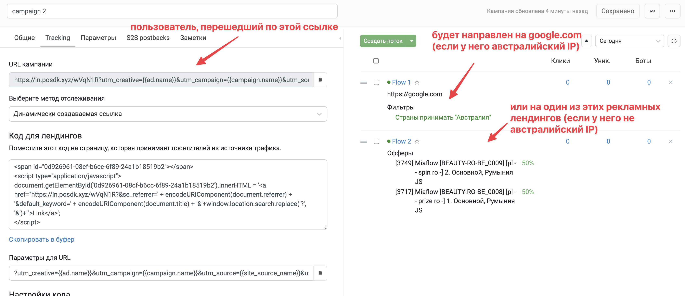
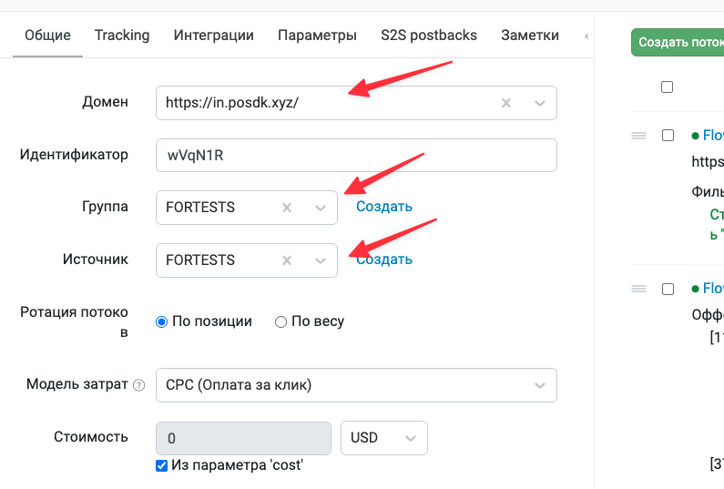
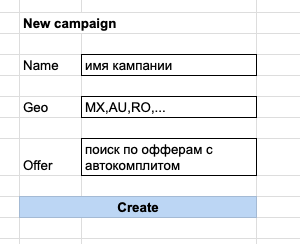
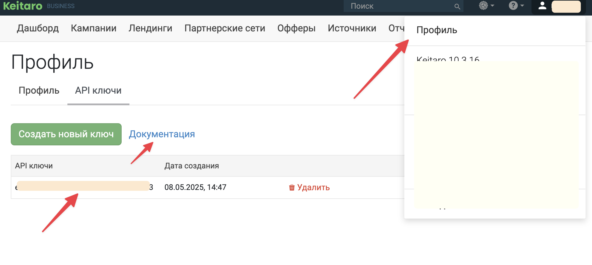

# Adrobot ТЗ

> Выгружено из Notion 2026-11-19:
> https://app.notion.com/p/mnovikov/Adrobot-2b01eb78a7bb80a1b188c3a4a1cad55e
> Картинки — в `assets/`, описания под ними добавлены при выгрузке.

Это тестовое задание покажет вам пример одной из систем, с которой мы работаем.
Эта система - рекламный трекер Keitaro, с его помощью мы отслеживаем прибыльность наших рекламных объявлений. С технической точки зрения - это конструктор ссылок, который редиректит пришедших пользователей согласно настроенным правилам, а потом показывает статистику редиректов, например:

> Скриншот: кампания `campaign 2`, URL кампании `https://in.posdk.xyz/wVqN1R?...`.
> **Flow 1** — редирект на `https://google.com`, фильтр «Страны принимать: Австралия»
> (пользователь с австралийским IP уходит на google.com).
> **Flow 2** — офферы `[3749] Miaflow [BEAUTY-RO-BE_0009] ...` 50% и
> `[3717] Miaflow [BEAUTY-RO-BE_0008] ...` 50% (остальные пользователи уходят на один из лендингов).
> У потоков колонки статистики: Клики, Уник., Боты.

Ваша задача состоит из 2 частей:

# 1. Написать “создаватор” кампаний. 

Он должен принимать название кампании, гео-код страны и ID оффера Keitaro и создавать кампанию, которая:
  - имеет 2 потока: первый поток ловит всех из указанной страны и редиректит на гугл, второй поток редиректит на выбранный оффер
  - имеет настроенные домен, группу и источник (все это тоже есть в API).
    

> Скриншот вкладки «Общие»: Домен `https://in.posdk.xyz/`, Идентификатор `wVqN1R`,
> Группа `FORTESTS`, Источник `FORTESTS` (стрелками выделены домен, группа, источник).
> Также видны: Ротация потоков — по позиции / по весу; Модель затрат CPC; Стоимость 0 USD.

Вот примерный интерфейс:

> Макет формы **New campaign**: Name — имя кампании; Geo — `MX,AU,RO,...`;
> Offer — поиск по офферам с автокомплитом; кнопка **Create**.

# 2. Написать редактор существующей кампании. 

Редактор должен уметь добавлять/удалять офферы в кампании. Этот редактор у нас уже есть, ниже - видео, как это выглядит и как работает. Вам нужно воспроизвести эту логику. Интерфейс - делайте на ваш вкус, главное, чтобы кнопки работали и цифры были верные.
[keitaro wrapper - test](https://youtu.be/jNloscEWCjA)

# Документация и API ключ

Документация к API Keitaro и ключ доступны в админке Keitaro.

> Скриншот Keitaro 10.3.16: меню профиля → Профиль → вкладка «API ключи»:
> кнопка «Создать новый ключ», ссылка «Документация», таблица ключей.

# Как сдавать тестовое

Проект должен быть написан на FastApi + SQLAlchemy. Фронт - можно сделать любой, хоть React, хоть HTML-ки с кусками jquery. 
Сдавать работу в виде ссылки на гитхабе с понятным README для миграций и запуска. Использование агентов типа Cursor/Windsurf категорически приветствуется.
